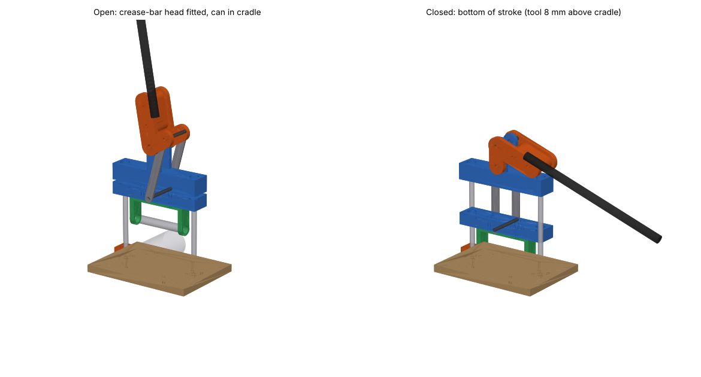

# Two-stage can crusher: CAD



A buildable crusher based on the simulator's results:

- **Stage 1:** a Ø20 steel crease bar across the middle of the can lying on its side. About 170 N, and it retracts cleanly.
- **Stage 2:** a flat, parallel 160 × 160 mm platen. Flat beat every curved, angled and hinged shape.

Both tool heads bolt to the same crosshead, which slides straight down two Ø12 steel guide posts. A hand lever drives it through a crank and two links. Near the bottom of the stroke the links straighten, so the leverage climbs exactly where the flattening force climbs.

## What's here

| File | Use |
|---|---|
| `can_crusher.py` | **The parametric model.** Every dimension is in `PARAMS` at the top. Rerun to regenerate everything. |
| `out/can_crusher_assembly_open.step`, `..._closed.step` | Full assembly (named, coloured parts) at the top and bottom of the stroke. Opens in SolidWorks, Fusion, Onshape, FreeCAD and others. |
| `out/step/*.step` | Each part on its own, in assembly coordinates. `platen_head.step` is the second tool head. |
| `out/stl/*.stl` | **Print-ready** parts, already laid flat in print orientation. |
| `out/dxf/base_plate.dxf`, `out/dxf/link.dxf` | Cutting profiles for the base plate and the two steel links. |
| `out/solidworks_global_variables.txt` | The same parameters, in SolidWorks Equations import format. |
| `out/bom.csv` | Hardware to buy plus the printed parts. |
| `out/parameters.json`, `out/hand_forces.json` | Derived dimensions, and the hand force at each crushed thickness. |
| `render_preview.py` | Rebuilds `out/preview.png`. |

## Changing dimensions

```bash
pip install -r requirements.txt          # CadQuery 2.8
python can_crusher.py                    # regenerate out/
python can_crusher.py --set handle_len=550 --set post_spacing=210 --set crank_r=50
```

Things the script recalculates for you:
- **Link length:** raised automatically if it's too short for the crank to clear the bridge.
- **Post length and stroke:** recomputed from the other dimensions.
- **Hand-force table:** printed using the simulated platen forces.

Useful knobs:

| Parameter | What it does |
|---|---|
| `tool_low_gap` | How far above the cradle the tool stops. This sets the final thickness, about 8 mm by default. |
| `handle_len`, `crank_r` | The lever ratio. |
| `crank_swing` | How far the handle travels. |
| `head_drop` | Clearance for the folded can halves above the crease bar. |
| `can_d`, `can_len` | Other can sizes. |
| `clearance` | Printed-fit tolerance. |

## Using it in SolidWorks

SolidWorks parts with an editable feature tree can't be generated outside SolidWorks. Two routes work:

1. **Quick (geometry):** File → Open → `can_crusher_assembly_open.step`. Tick *Import multiple bodies as parts* (it may be labelled "assembly") so each named part comes in separately. The model is **Z-up**; if it opens on its side, use the import option for the up axis, or rotate the assembly.
2. **Editable features:** open a single part's STEP and run **FeatureWorks** (Insert → FeatureWorks → Recognize Features; SolidWorks Professional/Premium). It turns the boxes, cylinders and holes back into extrudes and hole features you can drive.
   - Then use Tools → Equations → Import… → `solidworks_global_variables.txt` to load the same named variables (`post_spacing`, `crank_r`, `head_drop`, …).
   - Link the recognized dimensions to these variables by typing `="post_spacing"` into a dimension.

For large changes, editing `PARAMS` and re-exporting is quicker than rebuilding the features. The script keeps every part consistent with every other.

## Printing

Material and settings for all printed parts:
- **Material:** PETG minimum. PA-CF or PC-blend is better for the crosshead, bridge and crank plates.
- **Walls, top and bottom:** 5–6 walls, 6 top and 6 bottom layers.
- **Infill:** 40–60% gyroid.
- **Layer height:** 0.2 mm.
- **Orientation:** the STLs are already oriented. Load-bearing faces are flat on the bed, so press loads go along the layers rather than peeling them apart.

| Part | Qty | Size (mm) | Notes |
|---|---|---|---|
| crosshead | 1 | 237 × 50 × 30 | Press the LM12UU bearings in. Fits a 256 mm bed; rotate it 45° on 220 mm beds. |
| bridge | 1 | 237 × 50 × 122 | Ears point up. |
| crank_plate | 2 | 143 × 90 × 12 | 100% infill recommended, or cut from 6 mm steel/aluminium using the same outline. |
| handle_socket | 1 | 89 × 52 × 52 | |
| bar_head | 1 | 152 × 30 × 75 | Top plate on the bed. Add M6 heat-set inserts and two M5 set screws onto the bar. |
| platen_head | 1 | 160 × 160 × 70 | Face down. Bonding a 3 mm aluminium face plate on it is recommended. |
| cradle | 1 | 140 × 150 × 8 | 3 mm groove stops the can rolling. |
| post_foot | 2 | 40 × 40 × 25 | |

## Assembly

1. **Base and feet.**
   - Cut the 18 mm plywood (or 8–10 mm aluminium) base from `dxf/base_plate.dxf`.
   - Screw down the two feet and the cradle.
2. **Posts.**
   - Tap both ends of each Ø12 rod M6 × 15.
   - Bolt each post up through the base (head in the counterbore underneath).
   - Slide the crosshead, with its bearings, onto the posts.
   - Fit the bridge and clamp it down with M6 bolts and Ø20 washers. The press force pushes the bridge **up**, so these bolts carry the load. Don't rely on friction.
3. **Linkage.**
   - Cut the links from 20 × 5 mm steel flat bar (`dxf/link.dxf`, holes 155 mm apart).
   - Stack on the M10 pivot through the bridge ears: crank plates, then the handle socket between them.
   - Fit the M8 crank pin through the plates and links, and the M8 pin through the crosshead.
   - Use nylock nuts, snug but free to turn, with a little grease.
4. **Handle.** Push the Ø20 tube into the socket, drill Ø6.5 through it, and bolt it in.
5. **Tool heads.**
   - Bolt on the crease-bar head for stage 1 and press.
   - Swap to the platen head (4 × M6) for stage 2 and press again.

## Forces and strength

Hand force at the 450 mm grip, from the simulated flat-platen forces (`out/hand_forces.json`):

| Can thickness | Platen force (simulated) | Hand force | Effective ratio |
|---|---|---|---|
| 25 mm | 965 N | ≈ 88 N | 11 : 1 |
| 20 mm | 1,301 N | ≈ 103 N | 13 : 1 |
| 15 mm | 2,367 N | ≈ 149 N | 16 : 1 |
| 12 mm | 3,134 N | ≈ 152 N | 21 : 1 |

The crease bar needs only about 170 N at the tool, so about 15–20 N at the hand.

Rough strength checks at the 3.1 kN peak:

| Part | Check | Result |
|---|---|---|
| Crosshead | Bending | ≈ 8 MPa |
| Crosshead pin | Bearing pressure in the plastic | ≈ 8 MPa |
| Bridge | Bending | ≈ 12 MPa |
| Crank plates | Bending | ≈ 11 MPa (12 mm printed) |
| Links | Buckling margin | > 10× (steel 20 × 5) |
| Base | Bending | ≈ 15 MPa (18 mm plywood) |

PETG yields at roughly 40–50 MPa along the layers, so the printed parts have about a 3–4× margin. These are hand calculations, not FEA, and the design is **not** physically tested. Build it, try it on empty cans with gradually more force, and watch the crank plates and bridge ears first.

**Safety:** this is a pinch-point machine with kN-level forces near the bottom of the stroke. Keep fingers clear of the crosshead and the tool heads, and only crush empty, opened cans. A sealed can can burst.
