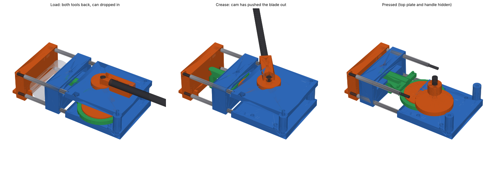

# Low-profile rotary can crusher



**One turn of a flat hand crank creases the can and then flattens it.** The can lies on its side. The whole mechanism is 93 mm tall (122 mm with the handle hub), 176 mm wide and 374 mm long, and bolts to a board.

## How it works

- **Layout:** the can lies between a fixed jaw and a sliding platen. A crease blade sits in a slot through the middle of the platen.
- **One rotor, two eccentrics:** a vertical-axis rotor carries two stacked eccentric discs.
  - The upper disc is a **cam**. It pushes the blade out ahead of the platen to crease the can.
  - The lower disc drives the **platen** through a strap and connecting rod.
- **Timing:** the cam leads the platen by 120°. The blade creases, then two rubber bands pull it back while the platen is still on its way.
- **Flush stop:** the blade stops flush with the platen face, so the platen presses as one solid flat face.
- **One cycle:** load with the handle pointing straight back, then turn one full turn.

| Crank angle | What happens |
|---|---|
| 225–240° | Loading window: blade and platen both clear a fresh can |
| 242° → 360° | Blade pushes into the can (about 164 N at the blade) |
| 0° | Full crease: blade tip 8 mm from the fixed jaw, platen still about 77 mm away |
| 0° → 120° | Blade springs back; platen closes and flattens (peak about 2.9 kN) |
| 120° | Platen 12 mm from the jaw |
| 120° → 230° | Both retract; lift out the flat can |

## What the simulation says

Run `node tools/study-rotary.mjs standard` to reproduce these (standard mesh, 12 oz can). The raw output is in `docs/rotary-timing-variants.txt`.

| Design | Peak crank torque | Peak platen force | Thickness after release | Energy |
|---|---|---|---|---|
| Cam leads by 105° | 87–99 N·m | 2.0–2.2 kN | 19–20 mm | 51 J |
| Cam leads by 120°, platen stops at 15 mm | 41 N·m | 2.1–2.4 kN | 17.3–17.8 mm | 42 J |
| **Cam leads by 120°, platen stops at 12 mm (this design)** | **47 N·m** | **2.9 kN** | **15.5 mm** | **51 J** |
| Cam leads by 120°, platen stops at 10 mm | 59 N·m | 3.6 kN | 14.6 mm | 60 J |

- **Timing is everything.** With a 105° lead the blade is still in the crease when the platen arrives. The folded halves get trapped beside it, and the torque doubles. At 120° the blade is out in time.
- **A fixed rib on the platen does not work.** A flat platen with a fixed 10 or 20 mm rib needs the same 2.2–2.7 kN as a plain flat platen (`tools/study-rib-platen.mjs`). The crease has to be deep, with room for the halves to fold up, and the bar has to leave before flattening.
- **Hand force.** The simulated 47 N·m does not include friction in the eccentric strap. With greased plastic (friction coefficient about 0.15), expect roughly 60 N·m. That is about 130 N at the end of the 450 mm handle. A longer handle lowers it in proportion.

## Files

| File | Use |
|---|---|
| `rotary_crusher.py` | Parametric model. Every dimension is in `P0` at the top. |
| `out_rotary/rotary_crusher_load.step`, `_crease.step`, `_pressed.step` | Full assembly at three crank angles. Open in SolidWorks with "Import multiple bodies as parts". |
| `out_rotary/step/*.step` | Each part on its own. |
| `out_rotary/stl/*.stl` | Print-ready parts, already turned to their print orientation. |
| `out_rotary/solidworks_global_variables.txt` | The parameters, for Tools → Equations → Import. |
| `out_rotary/bom.csv` | Hardware and printed parts. |
| `check_rotary.py` | Checks that every part is a valid solid and that nothing collides through a full turn. |
| `render_rotary.py` | Rebuilds the preview image. |

```bash
pip install -r requirements.txt
python rotary_crusher.py                              # regenerate out_rotary/
python rotary_crusher.py --set platen_gap=15 --set handle_len=500
python check_rotary.py platen_gap=15                  # collision check for a variant
```

The script lengthens the connecting rod automatically if the blade's cam foot would hit the platen. It also sets the handle so it points straight back at the loading position.

## Printed parts (11 parts, largest 181 × 176 mm)

| Part | Size as printed (mm) | Notes |
|---|---|---|
| bottom_plate | 181 × 176 × 22 | Holds the axle bolt head; screws to the board. |
| top_plate | 181 × 176 × 23 | Upper bearing for the rotor hub; two pegs underneath anchor the bands. |
| fixed_jaw | 93 × 176 × 63 | Printed on its back. |
| platen | 92 × 176 × 46 | Printed pressing-face down, so the guide bores are vertical. |
| conrod | 201 × 132 × 12 | Printed flat. Place it diagonally on a 220 mm bed. |
| rotor_lower, rotor_upper | Ø114 × 29, Ø114 × 41 | Platen eccentric and blade cam. Use 5+ walls and 50% infill or more. |
| blade | 69 × 92 × 110 | Printed standing on its cam foot, nose up. |
| handle_hub, knob, back_post ×2 | small | |

Use PETG at minimum; PA-CF or PC is better for the platen, the plates and the rotor. Use 5–6 walls and 40–60% gyroid infill.

## Hardware

See `out_rotary/bom.csv`. In short:
- 4 × M8 threaded rod, 205 mm, each inside a Ø12 tube 147 mm long. The tubes are the guide rails; the rods take the pressing force.
- 1 × M16 × 130 bolt as the rotor axle.
- 3 × M6 × 110 through the rotor stack.
- 2 × M8 × 110 for the back posts.
- A Ø10 dowel as the wrist pin.
- A Ø20 steel tube for the handle.
- Two rubber bands.
- An 18 mm plywood board.

## Assembly

1. **Rear frame.** Drop the M16 bolt up through the bottom plate. Put the lower rotor on it, eccentric up, with a washer under it.
2. **Platen drive.**
   - Slide the conrod's strap over the lower rotor's eccentric.
   - Put the conrod's small end into the platen's rear slot.
   - Drop the wrist pin in through the hole in the platen's top.
3. **Blade.** Push the blade into the platen slot from the front until its nose is flush. It then holds the wrist pin in.
4. **Upper rotor.**
   - Put it on the axle with the cam lobe 120° ahead of the platen eccentric. The three bolt holes only line up one way.
   - Add the two back posts and the top plate.
   - Add the handle hub, then fit the three M6 through-bolts.
5. **Rails.**
   - Thread the four M8 rods through the fixed jaw, the tubes and the platen.
   - Fit their nuts into the pockets in the rear plates.
   - Tighten until the tubes are clamped.
6. **Bands.** Loop a rubber band from each peg on the blade's foot to the peg under the top plate.
7. **Mount.** Screw the bottom plate and the fixed jaw to the board, and clamp or screw the board down. Grease the strap, the cam face, the tubes and the axle.

## Not yet proven

- **Not built or tested.** The model is collision-checked and every part is a valid solid, but nobody has printed it.
- **Reaction torque.** Turning the handle twists the whole unit with up to about 60 N·m. It must be clamped or screwed to something solid.
- **Friction is an estimate.** If the strap runs dry or the print is rough, the hand force will be higher.
- **Band return.** The simulation assumes the blade follows the cam back. If the bands are too weak the blade stays in the crease and the torque doubles. Use two bands per side if in doubt.
- **Strength is by hand calculation.**
  - Rear plates: about 12 MPa in bending at 2.9 kN.
  - Wrist pin bearing in the platen web: about 20 MPa. This is the most loaded printed spot, so print the platen with extra walls.
- **Pinch hazard.** There is 2.9 kN between the jaws and a rotating eccentric at the back. Keep fingers out while turning.
